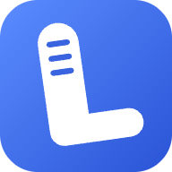
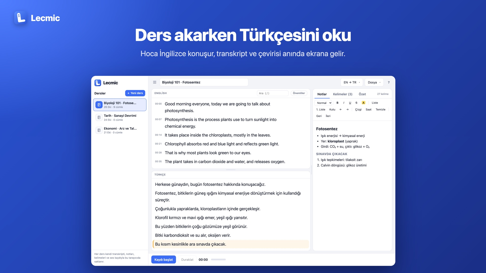
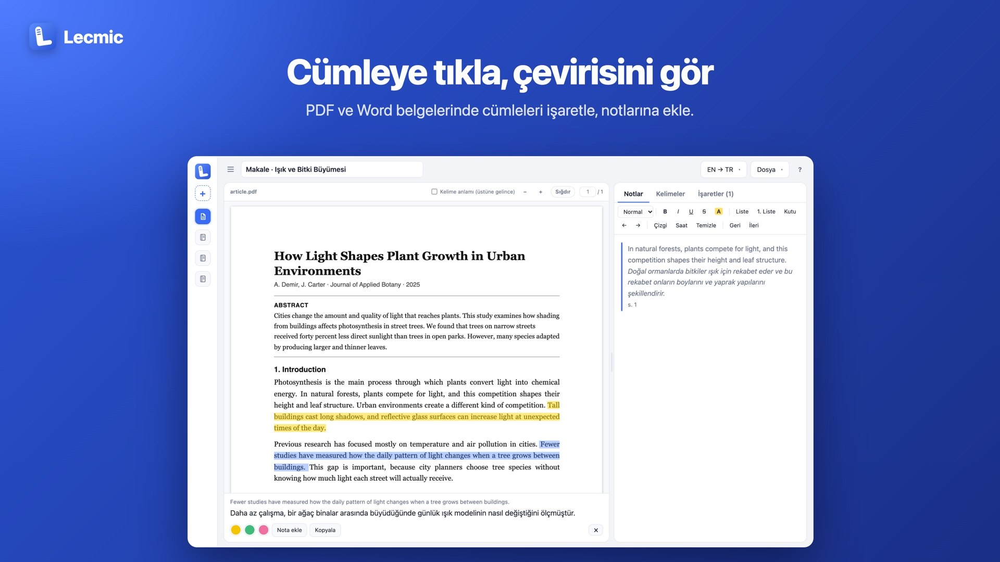

<p align="center">
  
</p>

<h1 align="center">Lecmic</h1>

<p align="center"><b>Ders kaydı, canlı çeviri, notlar. Hepsi tek yerde.</b><br>
İngilizce dersi dinlerken Türkçesini anında oku.</p>

<p align="center"><a href="https://lecmic.whyasaf.com"><b>lecmic.whyasaf.com</b></a> · Beta 0.9 · <a href="#english">English</a></p>



> **Beta:** Lecmic gelişmekte olan, ücretsiz bir uygulama. Bir şey ters giderse uygulamadaki **Ayarlar → Destek → Sorun bildir** ile yaz.

## Ne işe yarar

Dersler İngilizce, bazen anlamıyorsun. Lecmic dersi kaydederken konuşulanı yazıya döker, altına çevirisini yazar, yanında da not alırsın.

- **Canlı transkript ve çeviri:** Üstte konuşulan dil, altta çevirisi. Hoca konuştukça yazılır.
- **Dersler ve altındakiler:** "Fizik 101" gibi bir ders aç, PDF'lerini ve kayıtlarını onun altında topla. Her birinin notu ayrıdır.
- **Kelimenin cümledeki anlamı:** Bir kelimeye tıkla ya da PDF'te üstüne gel. Sözlük anlamı değil, o cümlede ne demek olduğu çıkar.
- **Kelime defteri ve kartlar:** Bilmediğin kelimeleri deftere ekle, kartlarla çalış. Bildiklerin giderek seyrek, bilmediklerin sık gelir.
- **Çeviri sekmesi:** Google Çeviri gibi; dil seç, yaz, çevir. Tek kelimede anlamlarını türüne göre gösterir.
- **Notlar:** Başlık, liste, yapılacaklar kutusu ve vurgu içeren sade bir not editörü. Bir cümleyi tek tıkla nota alıntılayabilirsin.
- **Önemli işareti ve arama:** Sınavda çıkacak cümleleri yıldızla, transkriptte ara.
- **Özet:** Dersin bölüm bölüm özetini çıkarır. Chrome'un cihazda çalışan yapay zekâsını kullanır, yoksa yerel bir yöntemle yapar.
- **Ses kaydı ve oynatıcı:** Ders MP3 olarak kaydedilir. Cümleye tıklayınca kaydın o anı çalar, hızlı dinleyebilirsin. Sekme yanlışlıkla kapanırsa kayıt kurtarılır.
- **Ses dosyasından transkript:** Hazır bir kaydı yükle, tarayıcının içinde yazıya dökülsün.
- **PDF ve Word okuma:** Makaleyi aç, cümleye tıkla, çevirisini gör, renkli işaretle, notlarına ekle.
- **Mikrofon testi:** Kayda başlamadan sesin gelip gelmediğine bak.
- **Yedek ve dışa aktarma:** Yedek alıp başka cihazda geri yükle. Notları ya da dersin tamamını Word, PDF ya da TXT olarak indir.
- **Uygulama gibi:** Bilgisayara ve telefona kurulur, internetsiz de açılır.
- **Diller:** Konuşma dili İngilizce ya da Türkçe. Çeviri Türkçe, İngilizce, Fransızca, İspanyolca ya da Urduca. Arayüz Türkçe ya da İngilizce.



## Nasıl kullanılır

1. [lecmic.whyasaf.com](https://lecmic.whyasaf.com) adresini **Chrome** ya da **Edge** ile aç.
2. Soldan **+ Yeni ders** ile bir ders aç.
3. **Kaydı başlat**'a bas, mikrofon iznini ver. Ders konuştukça yazı ve çevirisi gelir. Sağ tarafa not al.

PDF ya da Word okumak, yeni kayıt açmak ya da hazır bir ses dosyasını yazıya dökmek için üstteki **+ Ekle**.

**Uygulama olarak kurmak:** Windows'ta ve Mac'te adres çubuğunun sağındaki yükle simgesine bas. iPhone'da Safari → Paylaş → Ana Ekrana Ekle. Android'de Chrome menüsü → Uygulamayı yükle.

> Kaydetmeden önce hocandan izin al.

## Tarayıcı desteği

Canlı transkript tarayıcının konuşma tanıma özelliğini kullanır. Bu özellik **Chrome** ve **Edge**'de var, Firefox ve Safari'de yok. Belge okuma, notlar ve kelime defteri modern tarayıcıların hepsinde çalışır.

## Gizlilik

Lecmic'in sunucusu yok, hesap da yok. Reklam, takip ve çerez yok. Dersler, notlar, kelimeler, ses kayıtları ve belgeler **sadece senin cihazında** saklanır.

Yalnız şu özellikler çalışırken bazı veriler senin tarayıcından doğrudan bu hizmetlere gider, bize gelmez:

| Özellik | Nereye gider | Ne gider |
|---|---|---|
| Canlı transkript | Google (Chrome'un konuşma tanıması) | Mikrofon sesi |
| Çeviri ve kelime anlamı | Chrome'un kendi çevirmeni varsa hiçbir yere; yoksa Google Çeviri, o da cevap vermezse MyMemory | Çevrilecek metin |
| Ses dosyasından transkript | Hugging Face (model bir kez indirilir) | Ses gitmez, yazıya dökme tarayıcıda olur |
| Özet | Hiçbir yere, Chrome'un yapay zekâsı cihazda çalışır | — |
| Uygulama | Vercel | Dosya isteği (IP adresi ve tarayıcı bilgisi görülür). PDF, Word ve MP3 kütüphaneleri uygulamanın içinde (`vendor/`) |
| Ses dosyasından transkript kütüphanesi | jsDelivr | Dosya isteği |

Tarayıcı verilerini silersen dersler de silinir. Önemli dersler için **Ayarlar → Veri → Yedekle** kullan.

Ayrıntılar uygulamada: **Ayarlar → Destek → KVKK aydınlatma metni, Gizlilik politikası, Kullanım koşulları**.

## Mimari

Lecmic sunucusuz bir web uygulaması: bütün iş tarayıcıda döner, derleme adımı yok, kod düz JavaScript.

- **Veri:** Dersler, notlar ve kelimeler IndexedDB'de, her ders ayrı kayıt. Ses kayıtları ve belgeler de IndexedDB'de. `localStorage` sadece küçük ayarlar için.
- **Canlı transkript:** Chrome'un Web Speech API'si. Kayıt aynı anda `MediaRecorder` ile alınıp MP3'e çevrilir.
- **Ses dosyasından transkript:** Whisper, Transformers.js ile bir Web Worker içinde (WebGPU, yoksa WASM).
- **Çeviri:** Chrome'un yerleşik çevirmeni → Google → MyMemory.
- **Güvenlik:** Kütüphaneler repoda, CSP, dışarıdan gelen HTML DOMPurify ile temizleniyor.
- **Çevrimdışı:** Service worker, uygulama olarak kurulabilir (PWA).

Kararların nedenleri ve bedelleri [docs/adr](docs/adr) altında:

1. [Sunucu ve hesap yok, veriler cihazda](docs/adr/0001-sunucusuz.md)
2. [Veriler IndexedDB'de, her ders ayrı kayıt](docs/adr/0002-indexeddb.md)
3. [Whisper tarayıcıda, Worker içinde](docs/adr/0003-whisper-worker.md)
4. [Derleme adımı yok](docs/adr/0004-derleme-yok.md)
5. [Çeviride yedek zincir](docs/adr/0005-ceviri-zinciri.md)
6. [Kütüphaneler repoda, CSP ve HTML temizleme](docs/adr/0006-guvenlik.md)

## Dosyalar

```
index.html            sayfa
404.html              bulunamadı sayfası
css/app.css           görünüm ve animasyonlar
js/core.js            yardımcılar, ders verisi, ses deposu
js/i18n.js            arayüz dili
js/translate.js       çeviri, kelimenin cümledeki anlamı
js/transcript.js      transkript, paneller, kelime kutusu
js/notes.js           not editörü, kelime defteri, sekmeler, çeviri sekmesi
js/record.js          kayıt, MP3, kurtarma, oynatıcı
js/lessons.js         dersler ve klasörler, dışa aktarma, yedek
js/import.js          ses dosyasından transkript
js/summary.js         özet
js/doc.js             PDF ve Word okuma
js/settings.js        ayarlar, destek, yasal metinler, ilk açılış rehberi
js/cards.js           kelime kartları
js/main.js            kısayollar ve başlangıç
sw.js                 çevrimdışı çalışma
manifest.webmanifest  uygulama olarak kurma
vercel.json           yayın ayarları ve güvenlik başlıkları (CSP)
vendor/               kütüphaneler (bkz. vendor/README.md)
docs/adr/             mimari karar kayıtları
```

## Kullanılan kütüphaneler

- [pdf.js](https://github.com/mozilla/pdf.js) 4.10: PDF gösterme
- [mammoth](https://github.com/mwilliamson/mammoth.js): Word belgesi okuma
- [lamejs](https://github.com/zhuker/lamejs): MP3'e çevirme
- [DOMPurify](https://github.com/cure53/DOMPurify): dışarıdan gelen HTML'i temizleme
- [Transformers.js](https://github.com/huggingface/transformers.js) ve Whisper: ses dosyasından transkript

İlk dördü CDN'den değil repodaki `vendor/` klasöründen yüklenir; sürümleri, kaynakları ve hash'leri [vendor/README.md](vendor/README.md)'de.

Geri kalan her şey kütüphanesiz, düz JavaScript.

## İletişim

Sorun, öneri ya da soru için uygulamadaki **Sorun bildir** formu ya da [whyasaf.wa@gmail.com](mailto:whyasaf.wa@gmail.com).

---

## English

**Lecmic** is a free lecture assistant for university students, currently in beta. It transcribes and translates the lecture live while you listen. You can read PDFs in the same place, take notes, highlight text, study vocabulary with flashcards and get a section-by-section summary. Each course keeps its recordings and documents together.

- Open [lecmic.whyasaf.com](https://lecmic.whyasaf.com) in **Chrome** or **Edge**. The live transcript does not work in Firefox or Safari.
- No accounts, no server, no tracking. Your lessons stay on your device. The live transcript sends audio to Google through Chrome, and translation may send text to Google Translate or MyMemory.
- The interface is available in English: **Settings → General → Interface language**.
- Report problems from **Settings → Support → Report a problem** or at [whyasaf.wa@gmail.com](mailto:whyasaf.wa@gmail.com).
- Architecture: a serverless, zero-build vanilla JS app. Data lives in IndexedDB, Whisper runs in a Web Worker, libraries are vendored and the site ships a strict CSP. The decisions are recorded as ADRs in [docs/adr](docs/adr) (in Turkish).

## Lisans / License

[MIT](LICENSE) © 2026 whyasaf | Ömer Asaf Ak
