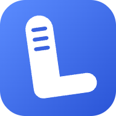
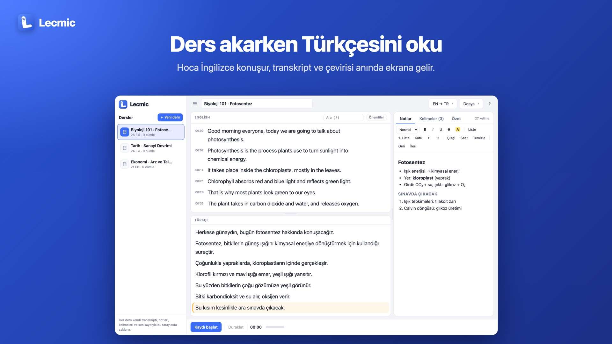
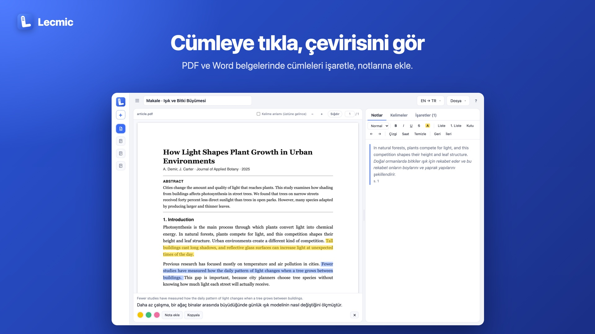

<p align="center">
  
</p>

<h1 align="center">Lecmic</h1>

<p align="center"><b>Ders kaydı, canlı çeviri, notlar. Hepsi tek yerde.</b><br>
İngilizce dersi dinlerken Türkçesini anında oku.</p>

<p align="center"><a href="https://lecmic.whyasaf.com"><b>lecmic.whyasaf.com</b></a></p>



## Ne işe yarar

Dersler İngilizce, bazen anlamıyorsun. Lecmic dersi kaydederken konuşulanı yazıya döker, altına Türkçesini yazar, yanında da not alırsın.

- **Canlı transkript ve çeviri:** Üstte İngilizce, altta Türkçe. Hoca konuştukça yazılır.
- **Notlar:** Başlık, liste, yapılacaklar kutusu ve vurgu içeren sade bir not editörü. Bir cümleyi tek tıkla nota alıntılayabilirsin.
- **Kelime defteri:** Bilmediğin kelimeye tıkla, anlamını gör, deftere ekle.
- **Önemli işareti ve arama:** Sınavda çıkacak cümleleri yıldızla, transkriptte ara.
- **Özet:** Dersin özetini çıkarır. Yapay zekâ servisi kullanmaz, Chrome'un kendi özetleyicisini ya da yerel bir yöntemi kullanır.
- **Ses kaydı:** Ders MP3 olarak kaydedilir. Sekme yanlışlıkla kapanırsa kayıt kurtarılır.
- **Ses dosyasından transkript:** Önceden kaydedilmiş bir dosyayı yükle, tarayıcının içinde yazıya dökülsün.
- **PDF ve Word okuma:** Makaleyi solda aç, cümleye tıkla, çevirisini gör, renkli işaretle, notlarına ekle.
- **Dersler:** Her dersin kendi transkripti, notları ve kayıtları var. Yedek alıp geri yükleyebilirsin.
- **Dışa aktarma:** Notları Word ya da TXT, dersin tamamını Word, PDF ya da TXT olarak indirebilirsin. Ses kaydı MP3 olarak iner.
- **Telefon:** Mobil tarayıcıda çalışır, ana ekrana uygulama gibi eklenir.
- **Diller:** Konuşma dili İngilizce ya da Türkçe. Çeviri Türkçe, İngilizce ya da Urduca. Arayüz Türkçe ya da İngilizce.



## Nasıl kullanılır

1. [lecmic.whyasaf.com](https://lecmic.whyasaf.com) adresini **Chrome** ile aç.
2. **Kaydı başlat**'a bas, mikrofon iznini ver.
3. Ders konuştukça yazı ve çevirisi gelir. Sağ tarafa not al.

PDF ya da Word okumak için **Dosya → Belge aç**, önceden kaydedilmiş bir ses için **Dosya → Ses dosyasından transkript çıkar**.

## Tarayıcı desteği

Canlı transkript tarayıcının konuşma tanıma özelliğini kullanır. Bu özellik **Chrome** ve **Edge**'de var, Firefox ve Safari'de yok. Diğer özellikler modern tarayıcıların hepsinde çalışır.

## Gizlilik

Lecmic'in sunucusu yok, hesap da yok. Dersler, notlar ve ses kayıtları **sadece senin tarayıcında** saklanır, kimseye gönderilmez.

Yalnız şu özellikler çalışırken bazı veriler dışarı gider:

| Özellik | Nereye gider | Ne gider |
|---|---|---|
| Canlı transkript | Google (Chrome'un konuşma tanıması) | Mikrofon sesi |
| Çeviri | Chrome'un kendi çevirmeni varsa hiçbir yere; yoksa Google Çeviri ya da MyMemory | Çevrilecek metin |
| Ses dosyasından transkript | Hugging Face (model bir kez indirilir) | Hiçbir ses gitmez, yazıya dökme tarayıcıda olur |
| Kütüphaneler | cdnjs, jsDelivr | Sadece dosya isteği |

Tarayıcı verilerini silersen dersler de silinir. Önemli dersler için **Dosya → Yedekle** kullan.

## Dosyalar

```
index.html            sayfa
404.html              bulunamadı sayfası
css/app.css           görünüm
js/core.js            yardımcılar, ders verisi, ses deposu
js/i18n.js            arayüz dili
js/translate.js       çeviri
js/transcript.js      transkript, paneller, kelime kutusu
js/notes.js           not editörü, kelime defteri, sekmeler
js/record.js          kayıt, MP3, kurtarma, oynatıcı
js/lessons.js         dersler, dışa aktarma, yedek
js/import.js          ses dosyasından transkript
js/summary.js         özet
js/doc.js             PDF ve Word okuma
js/main.js            kısayollar ve başlangıç
sw.js                 çevrimdışı çalışma
manifest.webmanifest  ana ekrana ekleme
vercel.json           yayın ayarları
```

## Kullanılan kütüphaneler

- [pdf.js](https://github.com/mozilla/pdf.js): PDF gösterme
- [mammoth](https://github.com/mwilliamson/mammoth.js): Word belgesi okuma
- [lamejs](https://github.com/zhuker/lamejs): MP3'e çevirme
- [Transformers.js](https://github.com/huggingface/transformers.js) ve Whisper: ses dosyasından transkript

## Lisans

[MIT](LICENSE) © 2026 whyasaf | Ömer Asaf Ak
# lecmic
